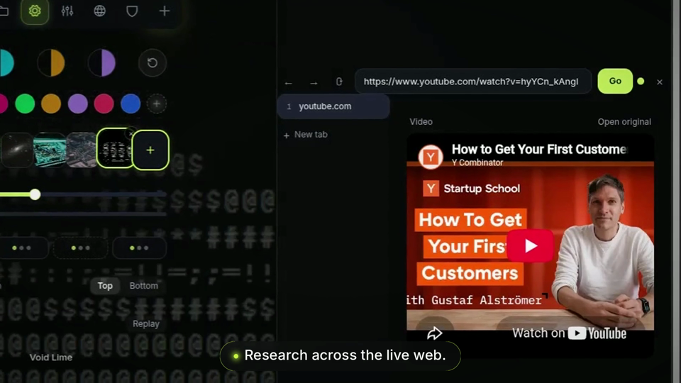
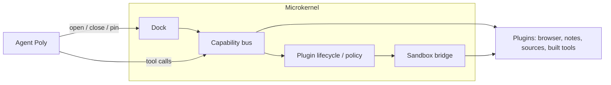

# PolyDocks

### Tell Poly what you need. It builds the tools to do it.

*Software that adapts to your work.*

[](docs/assets/showcase.mp4)
*Watch the showcase (1:08): the scripted product tour plays the whole workspace — dock, themes, research feed, reader, dashboard, notes — with zero model calls. Click to play.*

> 🎬 Watch: [Full product walkthrough](docs/assets/showcase.mp4)

Most AI assistants are limited to the tools they are given. They answer inside a chat box and forget everything when you close the tab. PolyDocks starts from a different idea: **software should adapt to people's needs, not the other way around** — so the workspace itself is operated by the agent. You give Poly a task. It can research the web, rearrange your dock, run code in a sandbox — and when no existing tool fits, it can **create a new plugin, run it, and bring it directly into your workspace**. The bet is simple — what if an agent could build the tools it needs? That is PolyDocks.

PolyDocks is an agentic workspace where AI doesn't stop at using existing tools. It can build new ones.

> *We're exploring a future where software doesn't have to be built for everyone in advance. It can be created around what each person actually needs.*

## What it does

- **Build.** Poly creates tools when existing capabilities aren't enough — a new plugin, generated, verified and versioned.
- **Use.** Generated tools become functional panels inside the workspace, next to the browser, sources feed and notes.
- **Work.** Browser, research, files, notes, and code execution operate side by side in one dock, arranged around the task.
- **Keep.** Generated tools persist in your workspace: reuse them, roll back when you don't like a change.
- **Remember.** Notes autosave, memory carries preferences between sessions.

## See it


*The dock bar holds every panel; the Orb is Poly. The scripted product tour plays here — token-free, replayable. Jump tools with Ctrl+Shift+1 to 9, or press Ctrl+K and ask.*


*Poly researches the web: the prompt ghost-types into the composer while the feed fills up beside the stage.*


*The Bitcoin viewer Poly built: live prices, chart, currency switch — generated, themed, live in the dock. Roll back if you don't like it.*


*Title and body autosave with a visible save state; flush on exit keeps the last keystrokes.*


*The browser next to the sources feed: everything Poly reads is saved to the workspace with its brand mark.*

## How Poly uses Meta technologies

PolyDocks is built for the **Meta Global AI Developer Hackathon**, and Meta's platform is the agent's entire brain and voice:

- **Reasoning + tool calling (`muse-spark-1.3`).** One loop over the Meta Model API drives everything: ~50 validated tools, deterministic fast paths for dock intents, harder tasks escalated to the model. Switching models is one env var, never a code change.
- **Voice (`muse-voice-transcribe-1.0`).** Talk to the dock hands-free; the browser never holds the key, a server proxy relays the realtime stream.
- **Media (`muse-image-1.0`).** Generated covers and share art, served from a daily-budgeted cache.

Details: [docs/hackathon.md](docs/hackathon.md) (the judge's guide) · [docs/meta-model-api.md](docs/meta-model-api.md) (integration reference).

## Architecture

PolyDocks is a **microkernel**: the core stays minimal — **dock + capability bus + plugin lifecycle/policy + sandbox bridge** — and everything else is a plugin.



The dock is the product surface: every item in it is a panel Poly opened. The capability bus is the only way tools touch the world (typed capabilities with Zod schemas, risk levels, a 30s timeout, and an audit trail). Plugins are single files with a manifest, sandboxed in an iframe behind a `postMessage` bridge, versioned with rollback. The browser is real Chromium when the worker runs, otherwise the built-in reader — sites that block embedding get an honest fallback card with an Open in new tab action. One SQLite database plus workspace files; single-user local today, per-user sandboxes as target. Details: [ARCHITECTURE.md](ARCHITECTURE.md), [docs/api.md](docs/api.md).

## Try it

Once it's running, ask Poly:

- *"Set up my morning: open the three sites I read first, and pin a notes tab beside them."*
- *"I'm learning Rust. Find the best free book, open it, and spin up a sandbox with a starter project."*
- *"Build me a tool that tracks what I read this week."*

## Run it locally

```bash
git clone https://github.com/0Pxyz/polydocks.git
cd polydocks
cp .env.example .env      # add your keys (table below)
docker compose up         # app on http://localhost:3000
```

Prefer Bun directly? `bun install && bun run dev` (app on `http://localhost:5173`, API on `:3000`).

| Variable | Needed for | Without it |
|---|---|---|
| `MODEL_API_KEY` | Poly answering anything | `model_unauthorized` (everything else still works) |
| `TINYFISH_API_KEY` | Web / news / paper research | Research tools stay offline |
| `MODAL_TOKEN_ID` + `MODAL_TOKEN_SECRET` | Code execution in sandboxes | Sandbox tools fail closed with a setup hint |

Details: [internal-docs/tinyfish.md](internal-docs/tinyfish.md) · contributor rules: [AGENTS.md](AGENTS.md).

## Status

- **Runs today:** single-user local runtime. **Not built yet:** per-user sandboxes, auth/multi-tenancy, remote tool store. Until those ship, **don't expose the server beyond localhost.**
- **Retired:** the knowledge-map experience was removed from the core and parked on the `future/city-experience` branch.

---

## Links

Demo video: [full walkthrough](docs/assets/showcase.mp4) · Judge's guide: [docs/hackathon.md](docs/hackathon.md) · Vision: [docs/product-philosophy.md](docs/product-philosophy.md) · License: [MIT](LICENSE)
