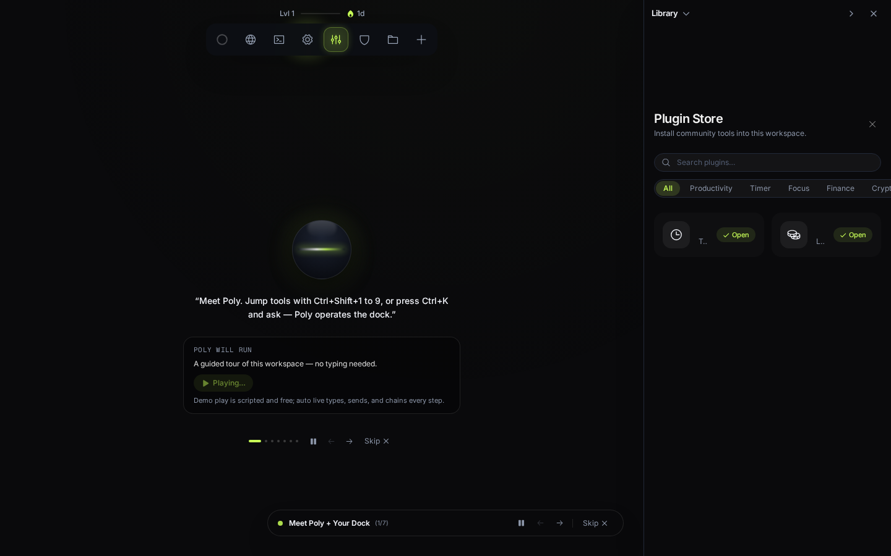
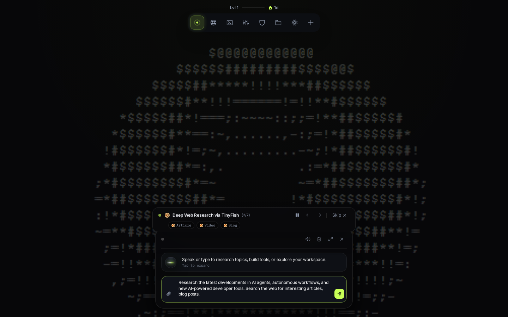
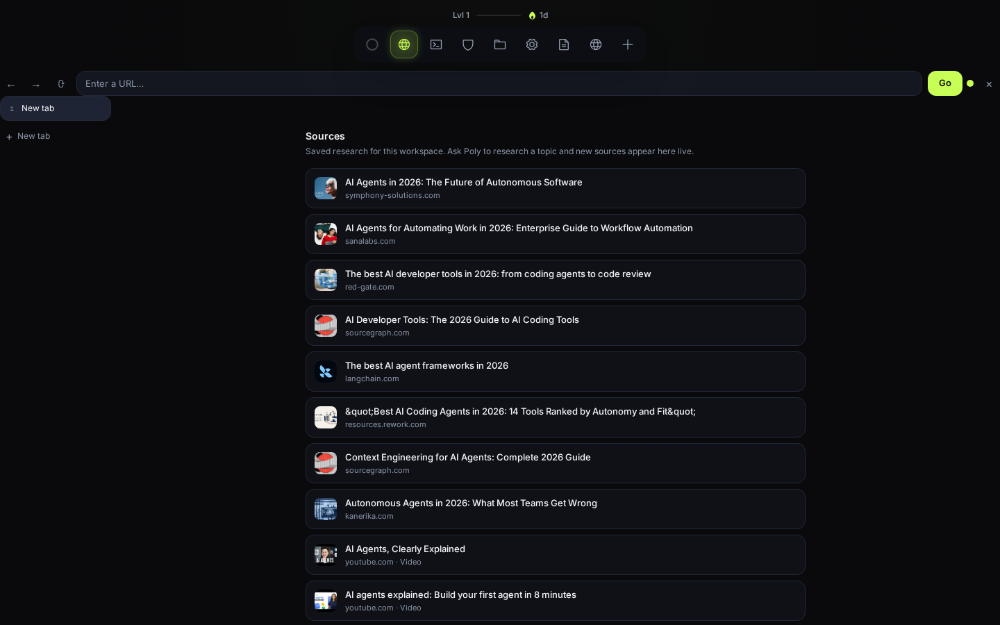
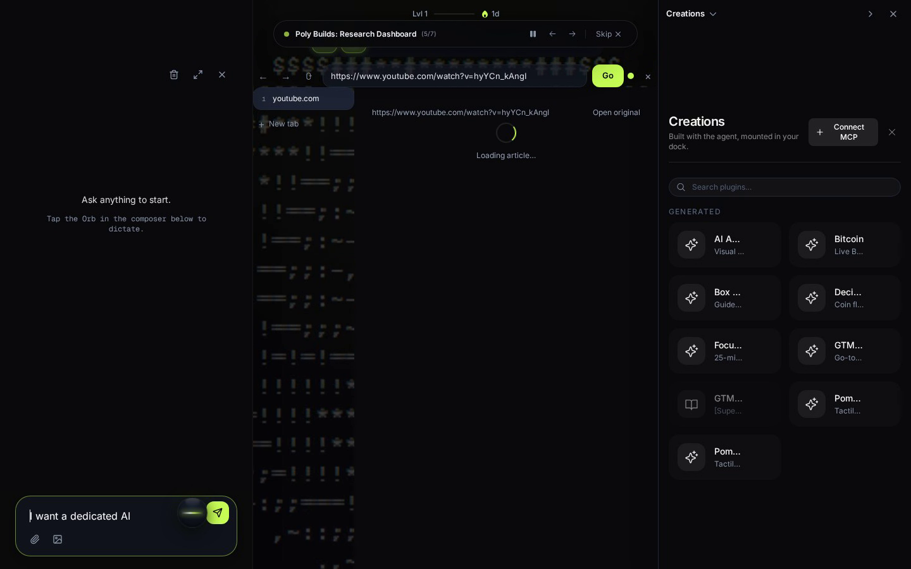
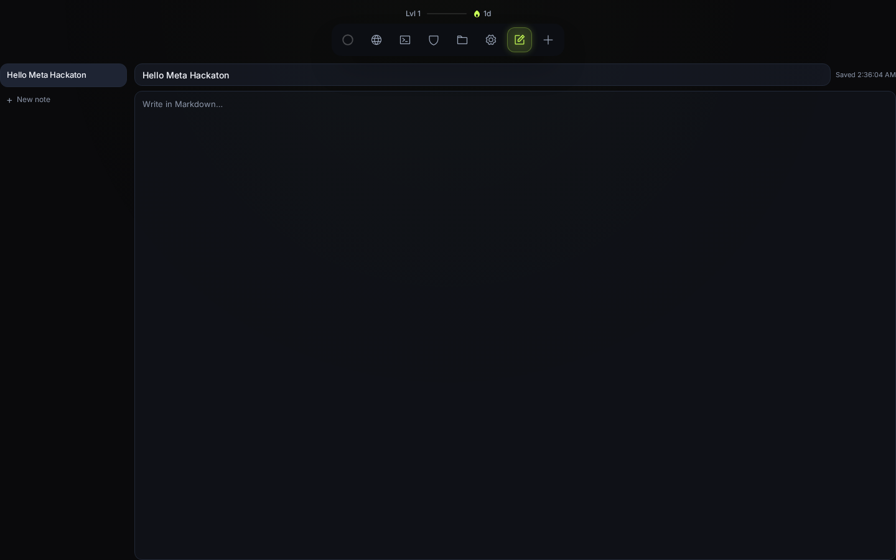
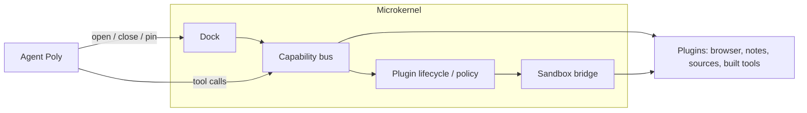

# PolyDocks

### Tell Poly what you need. It builds the tools to do it.

PolyDocks is an agentic workspace for people whose tools change every week — researchers, students, founders. Instead of a chat box with a fixed set of buttons, you get a dock that an AI agent operates: it opens, arranges, and when nothing fits, creates new tool panels directly in your workspace.


*The dock holds every panel; the Orb is Poly. Press Ctrl+K and ask, or jump with Ctrl+Shift+1 to 9.*

> Demo: [full product walkthrough](docs/assets/showcase.mp4) (1:08) · Judge's guide: [docs/hackathon.md](docs/hackathon.md)

## Introduction: what it is and what problem it solves

Most assistants are limited to the tools they were given. The moment your task does not fit those 30 pre-chosen tools, you are back to copy-paste: the agent cannot reach your workspace, and your workspace cannot learn new abilities.

PolyDocks inverts this. The workspace itself is operable by the agent:

- You state intent in chat or voice: *"Set up my morning: open the three sites I read first, and pin notes beside them."*
- Poly uses what exists (browser, notes, sources, files), rearranges the dock around the task, and persists the result.
- When no existing tool fits (*"Track what I read this week"*), Poly generates a new plugin, verifies it against a manifest contract, mounts it in the dock, and versions it so you can roll back.

The compounding part: built tools stay. Next month's work starts from last month's tools.

## Core capabilities: what Poly can do

**Operate the dock.** Open, close, pin, and arrange panels. The dock is the product surface — there is no separate canvas or window sprawl.


*Poly researches the web while the feed fills beside the stage.*

**Research and keep sources.** Search web, news, and papers (TinyFish, server-side), fetch full text, save to a workspace feed. Every page Poly reads opens in the Browser surface with an honest fallback for sites that block embedding.


*Browser next to the sources feed: everything Poly reads is saved with its origin.*

**Build tools when nothing fits.** One file + manifest (`id, title, icon, scope`), validated, mounted as a dock panel like any built-in. Edit in place, roll back on dislike.


*Bitcoin viewer Poly built: live prices, chart, currency switch — generated, themed, live in the dock.*

**Remember.** Notes autosave with visible save state, memory carries preferences across sessions, installed tools survive reload.


*Title and body autosave; flush on exit keeps the last keystrokes.*

**Run code in a sandbox (opt-in).** Sandbox tools execute with credentials-gated Modal backend. Unset credentials fail closed with a setup hint; the rest of the app keeps working.

## How it works

Four roles, one loop:

```
you → Poly → dock + capability bus → plugins
```

1. **You state intent.** Text in the composer or voice through the Orb.
2. **Poly checks what exists first.** Per request: `find_capabilities` → install from store if available → only then create. Never duplicates; fix means inspect, then patch in place.
3. **Poly acts through one typed bus.** Dock verbs (`dock.open/close/pin/list`), workspace files, research, and plugin lifecycle all cross the same capability bus: Zod-validated inputs, risk levels, 30s timeout, audit trail. Agent, CLI, and HTTP call the same facade functions with the same envelope — no shadow path where the demo works but the product does not.
4. **Results mount in the dock.** Browser, notes, sources, and anything Poly built are the same kind of object: a sandboxed panel. The host owns mounting, hiding, and hibernation; plugins never control their own lifecycle.

Every step streams over SSE (`tool.start`, `tool.done`, `plugin.created`, `done`), so you watch Poly work. Destructive writes and new installs pause for approval (`INSTALL_POLICY=ask` by default).

## Built with Meta's Muse models

Meta's platform is Poly's reasoning, voice, and image generation. Swapping models is env config, never a code change.

| Model | Role in PolyDocks |
|---|---|
| `muse-spark-1.3` (default) | Every agent turn: reasoning + tool calls. Drives the loop in `server/agent/loop.ts` — ~50 validated tools, 2 retries per call, `tool_choice: "auto"`. Fast path for dock intents runs deterministically; harder turns go to the model. |
| `muse-wonder-1.0` (preview, opt-in via `AGENT_MODEL`) | Deep reasoning for hard tasks (e.g. multi-paper comparison). Slower; same tool protocol. Set one env var to escalate. |
| `muse-voice-transcribe-1.0` | Hands-free dock operation. Mic stream is relayed through a server proxy (`server/voice/proxy.ts`); the browser never holds the key. Replies are spoken client-side. |
| `muse-image-1.0` | Generated covers and share art via the `generate_image` tool. Served from a cache with a daily budget ledger (`IMAGE_MAX_PER_DAY`, fails with `budget_exceeded` instead of spending). |

What we rely on from the API: `tool_choice: "auto"` only (anything else is HTTP 400), full assistant message + per-call `role: "tool"` messages with matching `tool_call_id`, Zod validation with model retry, `response_format: json_schema` for guaranteed JSON. Never `-contributor` variants: user notes stay private. Details: [docs/meta-model-api.md](docs/meta-model-api.md).

Research content comes from TinyFish (search + fetch, server-side only; key never reaches the browser). Web text is treated as untrusted data: size-capped, labeled, never allowed to trigger tools by itself.

## Architecture

PolyDocks is a **microkernel**. The core stays minimal; everything else is a plugin.



What each part does for you:

- **Dock** — the persistent control surface. Every item is a panel Poly opened. Mount on first open, keep alive hidden, hibernate past `LIVE_TAB_LIMIT`.
- **Capability bus** — the only way tools touch the world. Typed capabilities, policy checks, timeout, `executions` audit table you can inspect.
- **Plugin lifecycle / policy** — manifest validation (`apiVersion: 1`), install gate (`ask` by default), server-verified receipts, version history + rollback. Generated tools meet the same bar as built-ins.
- **Sandbox bridge** — isolation boundary. Guest plugins run in `<iframe sandbox="allow-scripts" srcdoc>` and talk to the host only through `postMessage` (`window.polydocks`: storage, capabilities, tasks, theme). No external scripts, no direct DOM access. Agent code execution goes through the opt-in Modal backend.

First-party surfaces (Browser, Notes, Sources, Files, Sandbox) are contract plugins under the same manifest and permission rules as generated ones — not special cases. One SQLite database + workspace files; single-user local today, per-user sandboxes as target.

Details: [ARCHITECTURE.md](ARCHITECTURE.md) · [docs/api.md](docs/api.md) · [docs/product-philosophy.md](docs/product-philosophy.md) · ADRs in [internal-docs/adr/](internal-docs/adr/).

## Quickstart

Prerequisites: Docker, or Bun >= 1.1.0 for direct dev.

```bash
git clone https://github.com/0Pxyz/polydocks.git
cd polydocks
cp .env.example .env      # add your keys (table below)
docker compose up         # app on http://localhost:3000
```

Direct dev (no Docker): `bun install && bun run dev` — web on `http://localhost:5173`, API on `:3000`.

| Variable | Needed for | Without it |
|---|---|---|
| `MODEL_API_KEY` | Poly answering anything | `model_unauthorized`; everything else still works |
| `TINYFISH_API_KEY` | Web / news / paper research | Research tools stay offline |
| `MODAL_TOKEN_ID` + `MODAL_TOKEN_SECRET` | Code execution in sandboxes | Sandbox tools fail closed with a setup hint |

Once running, try:

- *"Set up my morning: open the three sites I read first, and pin a notes tab beside them."*
- *"I am learning Rust. Find the best free book, open it, and spin up a sandbox with a starter project."*
- *"Build me a tool that tracks what I read this week."*

Checks: `bun run check` (typecheck + lint + test + build). Contributor rules: [AGENTS.md](AGENTS.md).

## Project status / Hackathon

Built for the **Meta Global AI Developer Hackathon**. All product code is original work from the competition period (origin ledger: `internal-docs/NEW_WORK.md`), MIT licensed.

What the demo proves (one continuous take, script in `internal-docs/demo-script.md`): theme change, TinyFish research into a browsable feed, three Poly-built plugins (breathing exercise, focus timer with persistence, a brief composing Sources + Notes through the bus), an edit with rollback, approval cards, plugin manager toggles, dock rearrangement, and a reload where everything is still there.

**Runs today:** single-user local runtime (`docker compose up`). **Not built yet:** per-user sandboxes, auth/multi-tenancy, remote tool store. Until those ship, do not expose the server beyond localhost.

---

Demo video: [full walkthrough](docs/assets/showcase.mp4) · Vision: [docs/product-philosophy.md](docs/product-philosophy.md) · License: [MIT](LICENSE)
