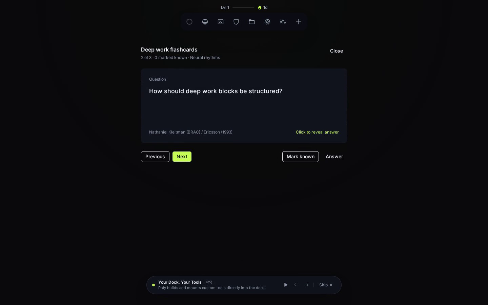
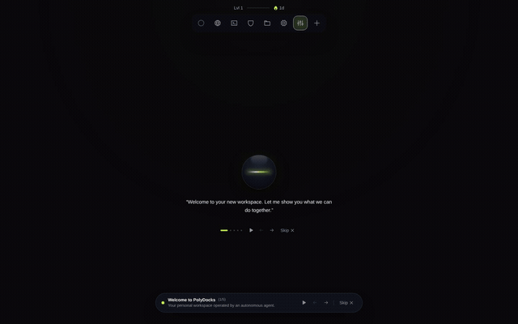
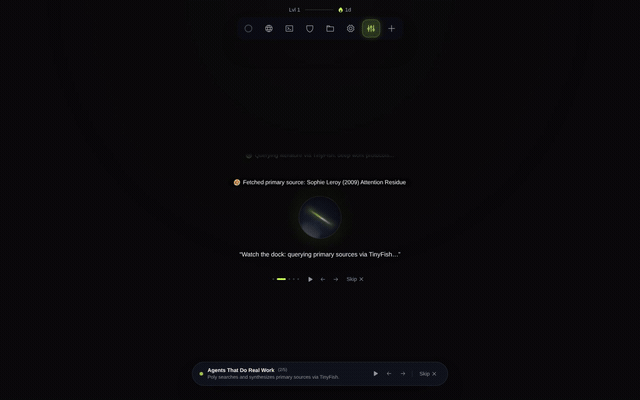
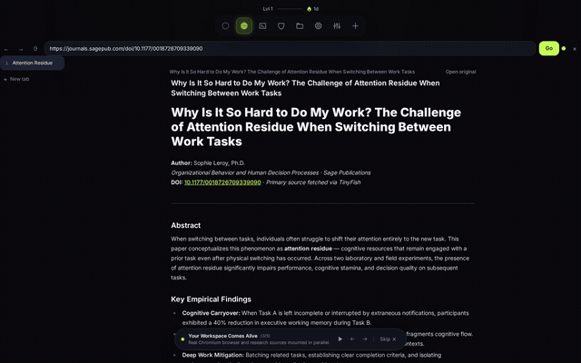
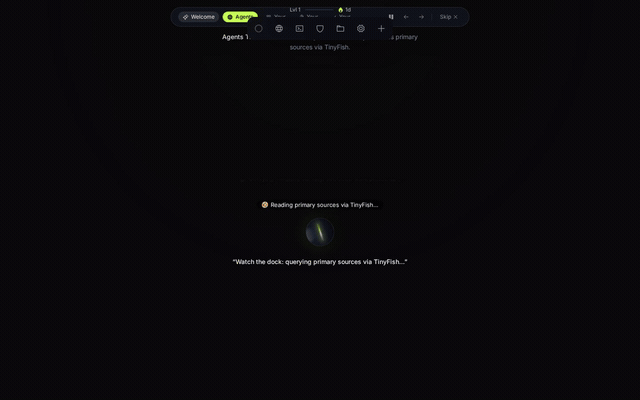
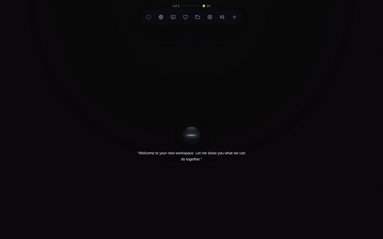
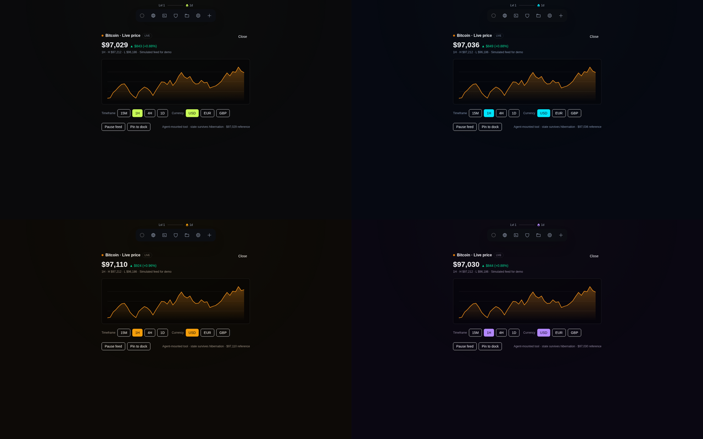
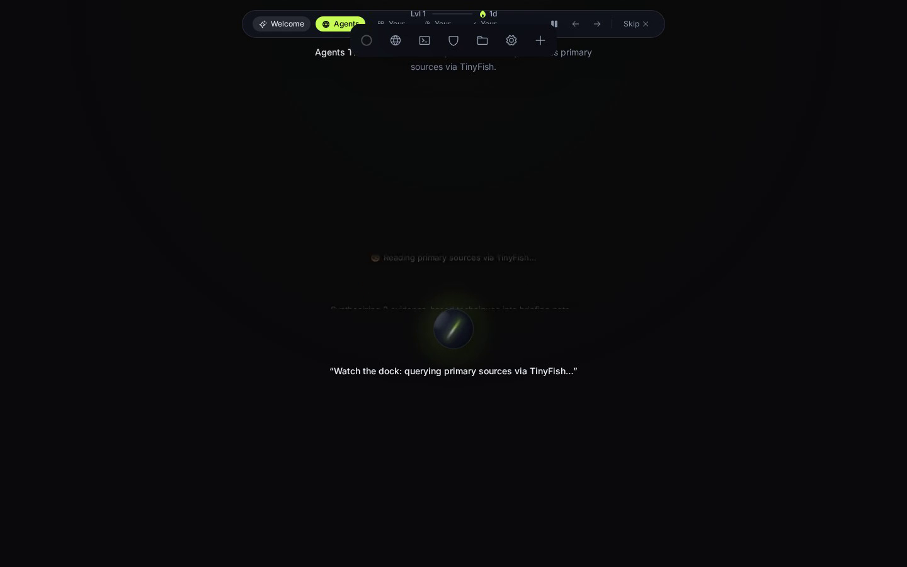
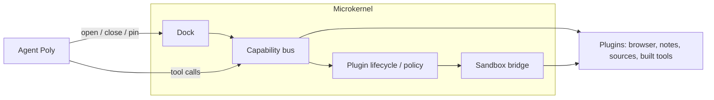

# PolyDocks

### Tell Poly what you need. It builds the tools to do it.

*Software that adapts to your work.*

[](https://dev.meta.ai/docs)
[](LICENSE)

<!-- HERO: a 10-15s GIF or video of the full flow (ask Poly → thoughts rise → browser, sources and terminal open in the dock). This is the first thing people see, so make it the best take. -->


> 🎬 **Watch the Live Onboarding Demo:** [Full Product Walkthrough (MP4)](docs/media/videos/polydocks-product-walkthrough.mp4)  
> **Feature Spotlights:** [01: Agentic Dock](docs/media/videos/feature-01-agentic-dock.mp4) • [02: Native Browser & TinyFish Research](docs/media/videos/feature-02-native-browser-research.mp4) • [03: Agent Builds Plugins](docs/media/videos/feature-03-agent-builds-plugins.mp4)

PolyDocks is an agentic workspace where AI doesn't stop at using existing tools. It can build new ones.

Ask Poly to research a topic, set up an environment, or create a tool for a specific task. Poly works across a browser, research sources, files and an isolated code sandbox. When existing capabilities aren't enough, it can build a new plugin, run it and add it to your dock.

The result isn't just another conversation with an AI. It's a workspace that changes as your work changes.

The idea is simple: software should adapt to people's needs, not the other way around.

---

## What makes Poly different?

Most AI agents are limited by the tools they're given. We built PolyDocks around a different idea: what if an agent could build the tools it needs?

> *You give Poly a task. It can create a new plugin, run it in an isolated environment, and bring it directly into your workspace. Then it uses that tool to get the job done. We're exploring a future where software doesn't have to be built for everyone in advance. It can be created around what each person actually needs. That's PolyDocks.*

- **Build.** Poly creates tools when existing capabilities aren't enough — a new plugin, generated, verified and versioned.
- **Use.** Generated tools become functional panels inside the workspace, live next to the browser, sources feed and notes.
- **Work.** Browser, research, files, notes, and code execution operate side by side in one dock, arranged around the task.
- **Keep.** Generated tools persist in your workspace: reuse them, roll back when you don't like a change.

---

## See it

<!-- Replace each placeholder with a real GIF / video / screenshot. Suggested filenames are in the paths. Keep captions, they help people who skim. -->

### The dock


*Everything you see is a panel Poly opened: browser, sources feed, notes, and tools it built for you. Pin what you use, background the rest.*

### Poly at work


*Short thoughts rise from Poly as it searches, reads, and opens things. No chat log to scroll. Finished results land as cards.*

### A real browser, inside the dock


*Chromium tabs with a URL bar, back/forward and lateral tabs (Atrium worker). Without the worker, pages open in the built-in reader — sites that block embedding get an honest fallback card with an Open in new tab action. Poly navigates it, and so can you.*

### Research that stays with you

*Web, news and paper search with full-text reading. Everything Poly reads is saved as a source in your workspace, with the site's brand mark. See it move in [02: Native Browser & TinyFish Research](docs/media/videos/feature-02-native-browser-research.mp4).*

### Code running next to your thinking


*Poly runs shell commands, edits files and starts dev servers in an isolated sandbox, and the live preview opens in the dock.*

### Tools built on demand


*Ask for a tool and it's open in seconds, in your theme, with rollback if you don't like it.*

### Voice


*Tap Poly and talk. Live transcription, hands-free dock operation.*

### Make it yours


*Backgrounds and themes apply everywhere, including tools Poly built.*

---

## How it feels to use

You tap Poly and say: *"Look into state-space models vs transformers, open the strongest paper, and set up somewhere I can run their code."*

1. Thoughts drift up from Poly: *Searching papers… Reading sources…*
2. A **browser** tab opens with the paper — the live page when the Atrium worker runs, the built-in reader otherwise (frame-blocked sites offer Open in new tab).
3. A **sources** panel fills with what Poly read, saved to the workspace.
4. A **terminal** comes up in a sandbox with the repo cloned and a preview tunneled back to you.

You never copied anything. The workspace simply became the right shape for the task.

---

## What Poly can do

| Capability | What you get | How it works |
|---|---|---|
| **Native browser** | Real Chromium tabs in the dock | Atrium remote-browser worker with a Bun-native WebSocket relay. Per-workspace sessions, short-lived viewer tokens; the worker secret never leaves the server. See [docs/browser.md](docs/browser.md) |
| **Research** | Search across web, news and papers; full-text fetch | TinyFish adapter, server-side (`server/discovery/tinyfish.ts`). API keys never reach the front end |
| **Code execution** | Shell, files and dev servers; previews as URLs | Modal sandboxes (`node:22-slim`), one volume per workspace. See [docs/sandbox.md](docs/sandbox.md) |
| **Tool building** | New tools on request, reversible | Each tool is a single file with a manifest, running sandboxed |
| **Dock control** | Poly arranges your workspace | `dock.open / close / pin / unpin / list / focus / next / prev / background` |
| **Voice** | Talk to the dock | Realtime proxy over `wss /api/voice/realtime`; the key stays on the server |
| **Generated media** | Covers, share cards, art | Muse Image with a daily budget ledger |

---

## The environment

The interface has three simple ideas.

**Poly.** Your point of contact with the agent. Tap to talk, or type. Poly's thoughts are short status lines that rise and fade as it works, so you always know what's happening without reading a transcript.

**The dock.** The bar that holds your workspace. Every item in it is a panel Poly opened, and Poly curates it with the same verbs you have: open, close, pin, focus, send to background. It reuses what's already open rather than duplicating it.

**Panels.** Everything you see in the dock. Browser, sources feed, notes, and any tool built for you. Panels read the app's theme, so they always look like part of it.

<!-- Optional: annotated screenshot with Poly, the dock and a couple of panels labeled. -->


---

## Architecture

PolyDocks is a **microkernel**: the core stays minimal — **dock + capability bus + plugin lifecycle/policy + sandbox bridge** — and everything else is a plugin.



- **Dock.** The product surface: a persistent control bar of tool panels (browser, sources feed, notes, store, settings, agent-built tools). Tools mount in the main or beside host, stay alive hidden, and hibernate past the live-tab limit. First-party surfaces: [browser](src/features/browser/NativeBrowserView.tsx), [sources feed](src/features/sources/SourcesView.tsx), [notes](src/features/notes/NotesView.tsx).
- **Capability bus.** The only way tools touch the world: typed capabilities (`server/plugins/bus.ts`) with a risk policy, 30s timeout, and an `executions` audit trail. The agent reaches them through `find_capabilities` / `invoke_capability`; the front end through `POST /api/plugins/:pluginId/:capability`.
- **Plugin lifecycle.** One file + manifest, sandboxed (`<iframe sandbox="allow-scripts" srcdoc>`, `window.polymax` bridge), versioned with rollback. Contract plugins (search, browser, notes, sources, files) are kernel-enforced; community tools install from the store.
- **Agent.** One loop over the Meta Model API (`muse-spark-1.3`, `server/agent/loop.ts`): deterministic dock/skill routers first, model turns with zod-validated tool calls, every step streamed over SSE. No multi-agent graph, no verifier.
- **Data.** One SQLite database (`bun:sqlite`, workspace-scoped tables for notes and sources) plus workspace files. Single-user local today; per-user sandboxes are the target.

Today vs target, with evidence, lives in [ARCHITECTURE.md](ARCHITECTURE.md) (Today / Target / Gaps). Product status in one line: **runs today** as a single-user local runtime (`docker compose up`); **not built yet** — per-user sandboxes, auth/multi-tenancy, remote tool store (see [Status](#status)).

---

## Things to try

Once it's running, ask Poly to build your day:

- **"Set up my morning: open the three sites I read first, and pin a notes tab beside them."** Poly arranges the dock around a routine.
- **"I'm learning Rust. Find the best free book, open it, and spin up a sandbox with a starter project."** Reading and doing, side by side.
- **"Compare these two papers and save the key claims as sources."** Research that stays in your workspace.
- **"Build me a tool that tracks what I read this week."** A tool made for you, open in the dock.
- **"Clone this repo, start it, and show me the preview."** Sandbox, tunnel and browser tab in one go.
- **"Change my background and apply a cyber theme."** The whole workspace, including tools Poly made, follows.
- **"Research state-space models, save the best sources, and keep appending your notes."** The sources feed fills live while your note autosaves beside it.

---

## Stack

Vite + React + TypeScript, Tailwind v4, shadcn/ui, zustand · Bun + Hono + SQLite (`bun:sqlite`), one process serving API and built front · single Docker image.

One model per job, configured by environment only (`server/agent/modelRegistry.ts`): agent `muse-spark-1.3` (the selector offers `muse-wonder-1.0` for hard tasks), voice `muse-voice-transcribe-1.0`, image `muse-image-1.0`, and an open-weight option via `AGENT_PROVIDER=openweight`. Model errors come back as structured `{ ok: false, error: { code, message, retryable } }` rather than a fake success. Details: [docs/meta-model-api.md](docs/meta-model-api.md).

---

## Status

- **Runs today:** a single-user local runtime. You bring `MODEL_API_KEY` (plus `TINYFISH_API_KEY` and `MODAL_*` for the full experience). Without a model key Poly answers `model_unauthorized`.
- **Not built yet:** per-user sandboxes, auth / multi-tenancy, a remote store for tools.  Until those ship, **don't expose the server beyond localhost.**
- **Retired:** the knowledge-map experience was removed from the core and parked on the `future/city-experience` branch.
- **Target:** per-user sandboxes with the agent as a privileged first-party plugin — see [ARCHITECTURE.md](ARCHITECTURE.md) (§2 Target, §3 Gaps).

---

## Run it locally

One container, one account. Docker is the simplest way to run PolyDocks;
everything (app, DB, files, memory) lives in the container plus two volumes.

```bash
git clone https://github.com/0Pxyz/polymax.git
cd polymax
cp .env.example .env      # add your keys (table below)
docker compose up         # app on http://localhost:3000
```

Your state persists in Docker volumes across restarts, and a second
`docker run` with fresh volumes starts a fully isolated account. To verify:
`./scripts/smoke-docker.sh` (build, health, persistence, isolation — 25 checks).

Prefer Bun directly? `bun install && bun run dev` (app on
http://localhost:5173, API on :3000).

### Config: one required key, the rest optional

| Variable | Needed for | Without it |
|---|---|---|
| `MODEL_API_KEY` | Poly answering anything | `model_unauthorized` (everything else still works) |
| `TINYFISH_API_KEY` | Web / news / paper research | Research tools stay offline |
| `MODAL_TOKEN_ID` + `MODAL_TOKEN_SECRET` | Code execution in sandboxes | Sandbox tools fail closed with a setup hint |
| `ATRIUM_WORKER_SECRET` (+ worker on `:7070`) | Real Chromium browser in the dock | Reader fallback for pages |
| `AGENT_SURFACE` | Tool catalog: `full` (everything, default) or `minimal` (dock verbs + discovery) | Restart the server after changing; `minimal` keeps turns cheap, `full` exposes theme/files/sandbox directly |

Details: [sandbox packaging](docs/docker-sandbox.md) · [model API](docs/meta-model-api.md) · [research API](docs/tinyfish.md) · [sandbox trust](docs/sandbox-trust.md). Contributor rules: [AGENTS.md](AGENTS.md).

---

Built for the **Meta Global AI Developer Hackathon** (Indie Track). Distributed under the [MIT License](LICENSE).