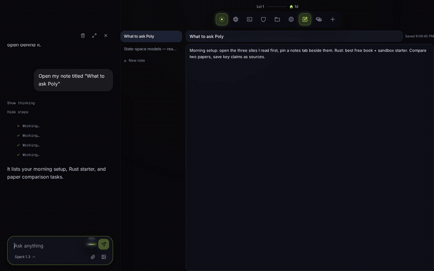
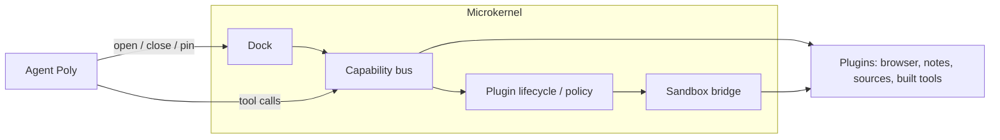
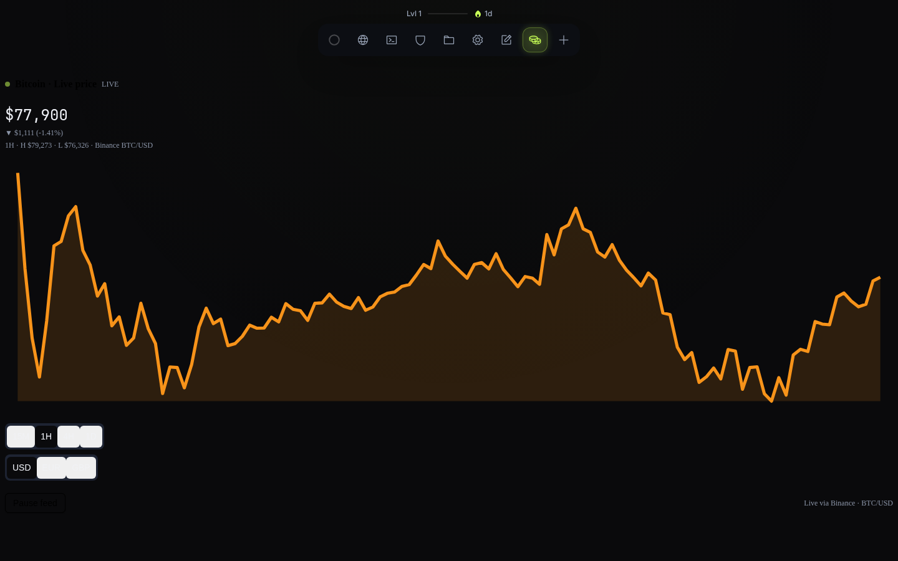
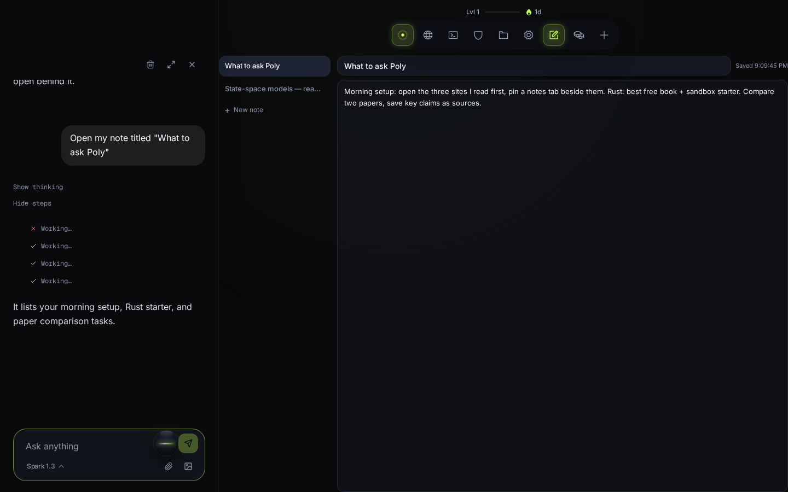
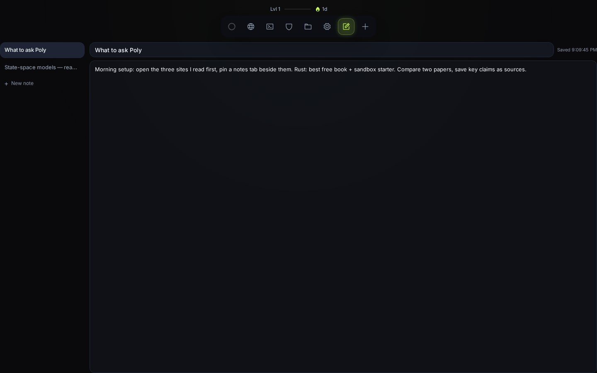

# PolyDocks

### Tell Poly what you need. It builds the tools to do it.

*Software that adapts to your work.*



> 🎬 Watch: [Full product walkthrough](docs/media/videos/polydocks-product-walkthrough.mp4)

PolyDocks is an agentic workspace where AI doesn't stop at using existing tools. It can build new ones.

> *You give Poly a task. It can create a new plugin, run it in an isolated environment, and bring it directly into your workspace. We're exploring a future where software doesn't have to be built for everyone in advance — what if an agent could build the tools it needs? The idea is simple: software should adapt to people's needs, not the other way around.*

## What it does

- **Build.** Poly creates tools when existing capabilities aren't enough — a new plugin, generated, verified and versioned.
- **Use.** Generated tools become functional panels inside the workspace, next to the browser, sources feed and notes.
- **Work.** Browser, research, files, notes, and code execution operate side by side in one dock, arranged around the task.
- **Keep.** Generated tools persist in your workspace: reuse them, roll back when you don't like a change.
- **Remember.** Notes autosave, memory carries preferences between sessions.

## Architecture

PolyDocks is a **microkernel**: the core stays minimal — **dock + capability bus + plugin lifecycle/policy + sandbox bridge** — and everything else is a plugin.



The dock is the product surface: every item in it is a panel Poly opened. The capability bus is the only way tools touch the world (typed capabilities, risk policy, audit trail). Plugins are single files with a manifest, sandboxed in an iframe, versioned with rollback. The browser is real Chromium when the worker runs, otherwise the built-in reader — sites that block embedding get an honest fallback card with an Open in new tab action. One SQLite database plus workspace files; single-user local today, per-user sandboxes as target. Details: [ARCHITECTURE.md](ARCHITECTURE.md), [docs/api.md](docs/api.md).

## The agent

One loop over the **Meta Model API** (`muse-spark-1.3`, env-swappable, never hardcoded). A deterministic router handles dock and skill intents without a model call; harder tasks escalate to the model turn, which calls ~50 zod-validated tools — every step streamed over SSE so you watch Poly work. Voice goes through realtime transcription with the key held server-side. Details: [docs/meta-model-api.md](docs/meta-model-api.md), [docs/hackathon.md](docs/hackathon.md).

## Try it

Once it's running, ask Poly:

- *"Set up my morning: open the three sites I read first, and pin a notes tab beside them."*
- *"I'm learning Rust. Find the best free book, open it, and spin up a sandbox with a starter project."*
- *"Build me a tool that tracks what I read this week."*

## Run it locally

```bash
git clone https://github.com/0Pxyz/polymax.git
cd polymax
cp .env.example .env      # add your keys (table below)
docker compose up         # app on http://localhost:3000
```

Prefer Bun directly? `bun install && bun run dev` (app on `http://localhost:5173`, API on `:3000`).

| Variable | Needed for | Without it |
|---|---|---|
| `MODEL_API_KEY` | Poly answering anything | `model_unauthorized` (everything else still works) |
| `TINYFISH_API_KEY` | Web / news / paper research | Research tools stay offline |
| `MODAL_TOKEN_ID` + `MODAL_TOKEN_SECRET` | Code execution in sandboxes | Sandbox tools fail closed with a setup hint |

Details: [docs/meta-model-api.md](docs/meta-model-api.md) · [internal-docs/tinyfish.md](internal-docs/tinyfish.md).

## Status

- **Runs today:** single-user local runtime. **Not built yet:** per-user sandboxes, auth/multi-tenancy, remote tool store. Until those ship, **don't expose the server beyond localhost.**
- **Retired:** the knowledge-map experience was removed from the core and parked on the `future/city-experience` branch.

---


*The dock bar holds every panel Poly opened — here the Bitcoin tool it built, live with real prices.*


*Short thoughts rise as Poly searches, reads, and opens things. Finished work lands as panels, not chat logs.*


*The Bitcoin viewer: generated, themed, live in the dock. Roll back if you don't like it.*


*Title and body autosave with a visible save state; flush on exit keeps the last keystrokes.*


*The browser next to the sources feed: everything Poly reads is saved to the workspace with its brand mark.*

## Links

Demo video: [full walkthrough](docs/media/videos/polydocks-product-walkthrough.mp4) · Working material: [internal-docs/](internal-docs/) · License: [MIT](LICENSE)
