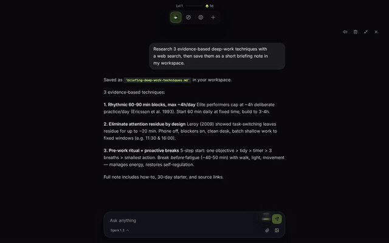

# PolyDocks

### Your own workspace, run by Poly.

[](https://dev.meta.ai/docs)
[](LICENSE)

<!-- HERO: a 10-15s GIF or video of the full flow (ask Poly → thoughts rise → browser, sources and terminal open in the dock). This is the first thing people see, so make it the best take. -->


PolyDocks is a way of using AI agents that feels like a place instead of a conversation. You talk (or type) to **Poly**, your agent, and it works inside **your dock**: it browses the web in a real browser, reads and saves sources, runs code in a sandbox, keeps your notes and files, and builds new tools for you on the spot. All of it sits side by side in a single, modern interface, instead of being scattered across a dozen tabs and apps.

---

## Why this exists

Software is becoming personal.

For decades we adapted ourselves to apps built for everyone: we learned their menus, their limits, their way of organizing things. Agents change the equation. If an agent can build and operate tools in seconds, then your software can finally be shaped around **you**: what you read, how you think, what you're working on this week.

PolyDocks is our bet on that future, made as something beautiful to actually use every day:

- **One place for what's usually scattered.** Research, reading, notes, code, files and terminals live together in one dock, laid out the way you want.
- **An agent that does, not just says.** Poly opens the page, saves the source, starts the server, opens the tool. You watch it work in a calm stream of short thoughts, and the result is something you can use right away.
- **AI-native from the ground up.** The agent isn't a sidebar bolted onto an app. The app is built so Poly can operate everything a person can: the same actions, the same surface.
- **Yours to reshape.** Ask for a new tool and it appears, themed like the rest of the app. Change the theme and everything follows.

---

## See it

<!-- Replace each placeholder with a real GIF / video / screenshot. Suggested filenames are in the paths. Keep captions, they help people who skim. -->

### The dock


*Everything you see is a panel Poly opened: browser, sources, notes, quests, files, terminal, and tools it built for you. Pin what you use, background the rest.*

### Poly at work


*Short thoughts rise from Poly as it searches, reads, and opens things. No chat log to scroll. Finished results land as cards.*

### A real browser, inside the dock


*Real Chromium tabs with a URL bar, back/forward and lateral tabs. Sites that block embedding open fine. Poly navigates it, and so can you.*

### Research that stays with you


*Web, news and paper search with full-text reading. Everything Poly reads is saved as a source in your workspace, with the site's brand mark.*

### Code running next to your thinking


*Poly runs shell commands, edits files and starts dev servers in an isolated sandbox, and the live preview opens in the dock.*

### Tools built on demand


*Ask for a tool and it's open in seconds, in your theme, with rollback if you don't like it.*

### Voice


*Tap Poly and talk. Live transcription, hands-free dock operation.*

### Make it yours


*Backgrounds and themes apply everywhere, including tools Poly built.*

---

## How it feels to use

You tap Poly and say: *"Look into state-space models vs transformers, open the strongest paper, and set up somewhere I can run their code."*

1. Thoughts drift up from Poly: *Searching papers… Reading sources…*
2. A **browser** tab opens with the paper, a real page, not a stripped-down reader.
3. A **sources** panel fills with what Poly read, saved to the workspace.
4. A **terminal** comes up in a sandbox with the repo cloned and a preview tunneled back to you.

You never copied anything. The workspace simply became the right shape for the task.

---

## What Poly can do

| Capability | What you get | How it works |
|---|---|---|
| **Native browser** | Real Chromium tabs in the dock | Atrium remote-browser worker with a Bun-native WebSocket relay. Per-workspace sessions, short-lived viewer tokens; the worker secret never leaves the server. See [docs/browser.md](docs/browser.md) |
| **Research** | Search across web, news and papers; full-text fetch | TinyFish adapter, server-side (`server/discovery/tinyfish.ts`). API keys never reach the front end |
| **Code execution** | Shell, files and dev servers; previews as URLs | Modal sandboxes (`node:22-slim`), one volume per workspace. See [docs/sandbox.md](docs/sandbox.md) |
| **Tool building** | New tools on request, reversible | Each tool is a single file with a manifest, running sandboxed |
| **Dock control** | Poly arranges your workspace | `dock.open / close / pin / unpin / list / focus / next / prev / background` |
| **Voice** | Talk to the dock | Realtime proxy over `wss /api/voice/realtime`; the key stays on the server |
| **Generated media** | Covers, share cards, art | Muse Image with a daily budget ledger |

---

## The environment

The interface has three simple ideas.

**Poly.** Your point of contact with the agent. Tap to talk, or type. Poly's thoughts are short status lines that rise and fade as it works, so you always know what's happening without reading a transcript.

**The dock.** The bar that holds your workspace. Every item in it is a panel Poly opened, and Poly curates it with the same verbs you have: open, close, pin, focus, send to background. It reuses what's already open rather than duplicating it.

**Panels.** Everything you see in the dock. Browser, notes, sources, quests, files, terminal, and any tool built for you. Panels read the app's theme, so they always look like part of it.

<!-- Optional: annotated screenshot with Poly, the dock and a couple of panels labeled. -->


---

## Architecture

---

## Things to try

Once it's running, ask Poly to build your day:

- **"Set up my morning: open the three sites I read first, and pin a notes tab beside them."** Poly arranges the dock around a routine.
- **"I'm learning Rust. Find the best free book, open it, and spin up a sandbox with a starter project."** Reading and doing, side by side.
- **"Compare these two papers and save the key claims as sources."** Research that stays in your workspace.
- **"Build me a tool that tracks what I read this week."** A tool made for you, open in the dock.
- **"Clone this repo, start it, and show me the preview."** Sandbox, tunnel and browser tab in one go.
- **"Change my background and apply a cyber theme."** The whole workspace, including tools Poly made, follows.
- **"Turn this topic into learning quests."** Structured quests with XP progression.

---

## Stack

Vite + React + TypeScript, Tailwind v4, shadcn/ui, zustand · Bun + Hono + SQLite (`bun:sqlite`), one process serving API and built front · single Docker image.

One model per job, configured by environment only (`server/agent/modelRegistry.ts`): agent `muse-spark-1.3` (the selector offers `muse-wonder-1.0` for hard tasks), voice `muse-voice-transcribe-1.0`, image `muse-image-1.0`, and an open-weight option via `AGENT_PROVIDER=openweight`. Model errors come back as structured `{ ok: false, error: { code, message, retryable } }` rather than a fake success. Details: [docs/meta-model-api.md](docs/meta-model-api.md).

---

## Status

- **Runs today:** a single-user local runtime. You bring `MODEL_API_KEY` (plus `TINYFISH_API_KEY` and `MODAL_*` for the full experience). Without a model key Poly answers `model_unauthorized`.
- **Not built yet:** per-user sandboxes, auth / multi-tenancy, a remote store for tools.  Until those ship, **don't expose the server beyond localhost.**
- **Retired:** the knowledge-map experience was removed from the core and parked on the `future/city-experience` branch.

---

## Quickstart

Prerequisite: [Bun](https://bun.sh) v1.1+

```bash
git clone https://github.com/0Pxyz/polymax.git
cd polymax
cp .env.example .env      # add MODEL_API_KEY (+ TINYFISH_API_KEY for research)
bun install
bun run dev               # app on http://localhost:5173 (API on :3000)

# in another terminal, for the real browser surface:
ATRIUM_WORKER_SECRET=dev-secret-change-me npx atrium-worker
```

Or `docker compose up`. Docker instructions and contributor rules: [AGENTS.md](AGENTS.md).

---

Built for the **Meta Global AI Developer Hackathon** (Indie Track). Distributed under the [MIT License](LICENSE).