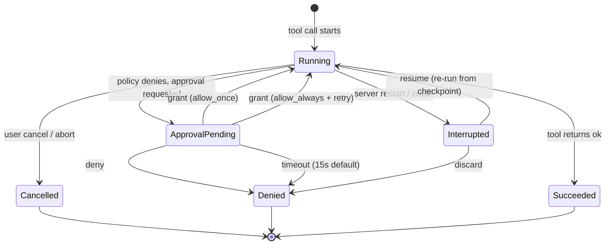

# Approval and Resumable Execution Lifecycle (#167)

> **Status:** specification only — no runtime behavior changed in this slice.
> Verified against `dev` at `c2462c1` (2026-10-31). All file pointers below
> were read from the tree; anything not observed is marked `TO VERIFY`.

## 1. Problem

Long-running and approval-gated operations have no pause/resume lifecycle today:

- `approval_required` is fail-fast text, never pause/resume. `server/agent/loop.ts`
  has zero approval handlers (the word `approval` appears only in prompt text
  and the receipt check at `loop.ts:861-864`).
- The capability bus (`server/plugins/bus.ts:254-293`) evaluates policy via
  `evaluateCapabilityPolicy` and records `denied` executions, but a denied
  capability ends the tool call — the agent turn does not pause waiting for a
  later grant.
- `ApprovalManager.requestApproval` (`server/plugins/approval.ts:48-110`)
  halts the caller until `resolveApproval` or a 15s timeout resolves
  `denied`, and optionally emits `approval.requested`. The front-end event
  contract (`src/lib/agent/events.ts`) drops that type
  (`events.ts:529-530` area — `approval.requested` has no UI mapper), while
  the store (`src/lib/agent/conversationStore.ts:662`) handles only
  `approval.required` (fail-fast receipt shape from `server/agent/events.test.ts:63-78`).
- `InlineApprovalCard` (`src/features/dock/InlineApprovalCard.tsx`) exists and
  posts to `/api/capabilities/approvals/:id`, but has no imports outside its
  own module — it is orphaned from the conversation flow.
- Server restart marks running tasks `interrupted` with no resume
  (`server/agent/taskRunner.ts:335-360`): `recoverInterruptedTasks` flips
  `running` rows to `interrupted` with `error = 'Task interrupted by server
  restart'`. Cancellation propagates as an error through the bus abort path
  (`server/plugins/bus.ts:379-381`, 30s default capability timeout).

## 2. Lifecycle



### State definitions

| State | Owner | Durable? | Notes |
|---|---|---|---|
| `Running` | bus + task row (`tasks.status = 'running'`) | yes (tasks table) | Abort via `AbortController`, 30s default cap |
| `ApprovalPending` | `ApprovalManager.pendingApprovals` | **no** (in-memory `Map`) | Restart loses it; must be re-requested |
| `Denied` | execution row (`status = 'denied'`) + receipt | yes | Receipt check treats it as terminal for the turn |
| `Cancelled` | task row + bus abort error | yes | Propagates as `ok:false`, retryable |
| `Interrupted` | task row (`status = 'interrupted'`) | yes | Set only by `recoverInterruptedTasks` on boot |
| `Succeeded` | execution row (`status = 'success'`) + receipt | yes | Receipts are truth for the model |

## 3. Envelopes

All shapes reuse the existing facade envelope
(`{ ok, data?, events? }` / `{ ok:false, error, retryable, code? }` from
`docs/api.md`); no new top-level protocol.

### 3.1 Approval request (server event)

```json
{
  "type": "approval.requested",
  "payload": {
    "id": "appr_1690000000000_abc123",
    "pluginId": "sources",
    "capabilityId": "sources.publish",
    "risk": "destructive",
    "scope": "workspace:default",
    "summary": "Approval required for capability ...",
    "input": {},
    "createdAt": "2026-10-31T00:00:00.000Z"
  }
}
```

Source: `server/plugins/approval.ts:88-105` (emitted only when the caller
passes `emit`; the bus path today does not pass one — gap).

### 3.2 Approval decision (client → server)

```http
POST /api/capabilities/approvals/:id
Content-Type: application/json

{ "decision": "allow_once" | "allow_always" | "deny" }
```

Source: `InlineApprovalCard.handleResolve` posts exactly this shape.
`resolveApproval` returns `false` when the id is unknown or not `pending`.

### 3.3 Fail-fast receipt (current agent-visible shape)

```json
{
  "type": "tool.result",
  "status": "approval_required",
  "message": "Deletion paused: user approval required"
}
```

The UI mapper turns this into `approval.required`
(`server/agent/events.test.ts:63-78`, `conversationStore.ts:662-668`).
This is **not** a pause — the turn ends here today.

### 3.4 Task interruption (durable)

```sql
UPDATE tasks
SET status = 'interrupted',
    error = 'Task interrupted by server restart',
    updated_at = :now
WHERE status = 'running';
```

Source: `server/agent/taskRunner.ts:343-350`. Resume is a future
re-run from the task's `input_json` checkpoint; idempotency key is the
task id (`TO VERIFY`: no checkpoint format is defined yet).

## 4. Pause / resume contract (target, not implemented)

1. A capability denied for missing approval creates a durable
   `ApprovalPending` record (not just the in-memory `Map`) keyed by
   `(taskId, toolCallId)`, with the same `timeoutMs` semantics (default
   15s, expiry → `Denied`).
2. The agent turn **pauses** (no stuck/duplicate accounting while paused)
   and the UI shows `InlineApprovalCard` from the `approval.requested`
   event. `approval.requested` must be added to the UI event mapper
   (today it is dropped).
3. `allow_once` resumes exactly one paused tool call; `allow_always`
   records a grant (`pluginRegistry.grantPermission`) and resumes;
   `deny`/timeout marks the tool `Denied` and returns control with
   `retryable: false` unless the capability declares otherwise.
4. `Interrupted` tasks never auto-resume. Resume is an explicit user or
   agent action that creates a new attempt under the same task id with an
   incremented attempt counter; the old attempt stays in history.
5. Sandbox coordination: task cancel/restart must also terminate or detach
   the backing sandbox (`sandbox_terminate`); sandbox lifetime is owned by
   the host, never the plugin (`docs/sandbox.md`, `docs/plugins/lifecycle.md`).
6. Idempotency: retries reuse `(taskId, attempt, toolCallId)`; capability
   handlers must treat a repeated envelope as read-only when the first
   attempt already produced a receipt.

## 5. What closes #167

- [x] This document with the state diagram + envelope shapes above.
- [ ] No code changes in this slice (deferred implementation stays in the
  fork/backlog until the execution path is unified).

## 6. Implementation backlog (not this slice)

- Durable `approvals` table + `approval.requested` UI mapping.
- Pause/resume in `runAgentLoop` (currently zero approval handlers).
- Wire `InlineApprovalCard` into the conversation flow.
- Resume-from-checkpoint format for `interrupted` tasks.
- Retry/idempotency semantics per capability.
