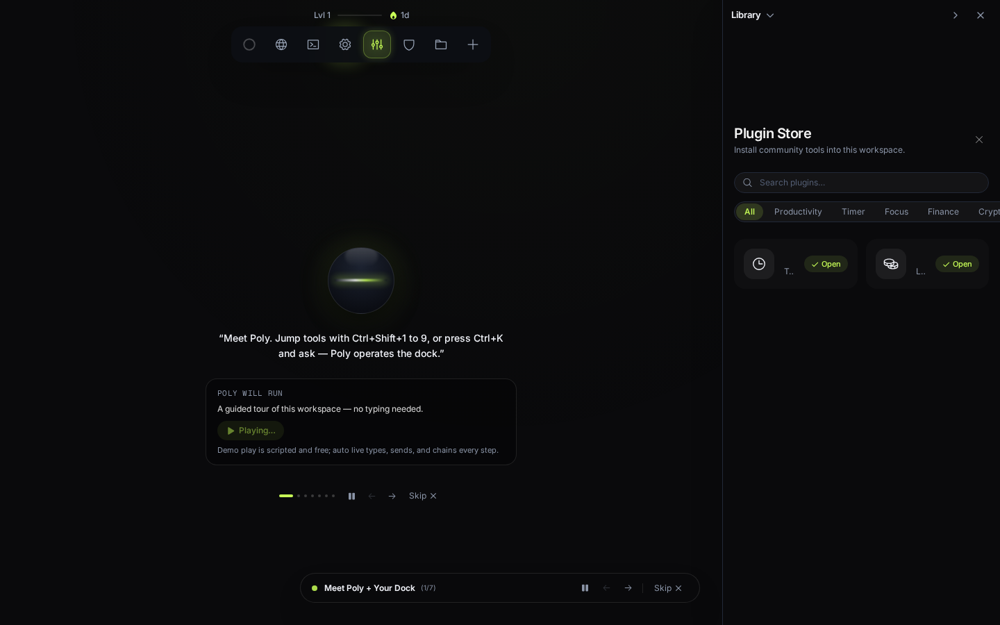
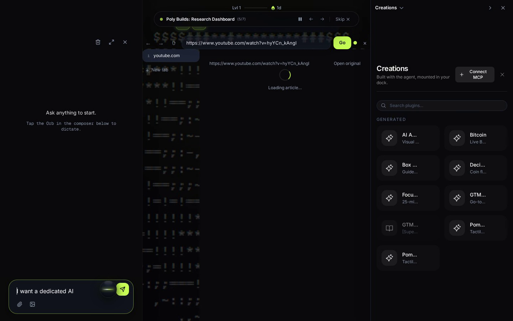
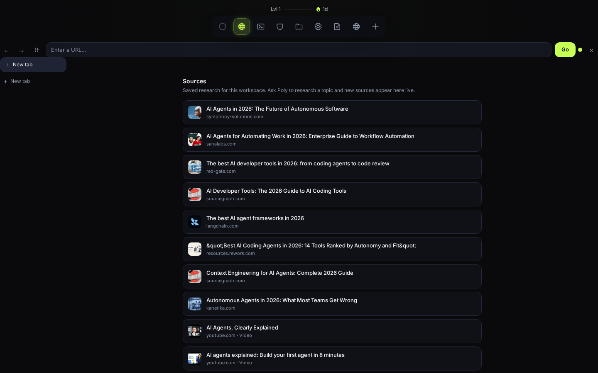

# PolyDocks — judge's guide

PolyDocks is an agentic workspace for people whose tools change every week — researchers, students, founders. Instead of a chat box with a fixed set of buttons, you get a dock that an AI agent operates: it opens, arranges, and when nothing fits, creates new tool panels directly in your workspace.


*Every panel is a tool Poly opened. The Orb is Poly. Demo: [full walkthrough](assets/showcase.mp4) (1:08).*

## The 30-second version

1. You state intent: *"Set up my morning: open the three sites I read first, and pin notes beside them."*
2. Poly uses what exists (browser, notes, sources, files) and rearranges the dock around the task.
3. When no tool fits (*"Track what I read this week"*), Poly generates a new plugin, verifies it against a manifest contract, mounts it in the dock, and versions it so you can roll back.
4. Built tools stay. Next month starts from last month's tools.

## Problem

Assistants ship with a fixed tool list. The moment a task falls outside those 30 pre-chosen tools, the user is back to copy-paste: the agent cannot reach the workspace, and the workspace cannot learn new abilities. Shipping a new app for every need does not scale, and a chat log is a poor place to do real work.

## What to try (evaluation path)

Run the app (see below), then ask Poly:

1. *"Find the best free Rust book, open it, and pin notes beside it."* — tests research + dock arrangement + persistence.
2. *"Build me a tool that tracks what I read this week."* — tests `find_capabilities` first, then `create_plugin`, then mount in the dock.
3. *"Change the theme, then roll back the tool you just built."* — tests versioning and host-owned lifecycle.

Expected: every step streams over SSE (`tool.start`, `tool.done`, `plugin.created`), destructive writes pause for approval (`INSTALL_POLICY=ask`), and a reload keeps everything.


*Bitcoin viewer Poly built: live prices, chart, currency switch — generated, themed, live in the dock.*

## How it works

```
you → Poly → dock + capability bus → plugins
```

- **Agent loop** (`server/agent/loop.ts`): one loop over the Meta Model API. Fast dock/skill intents route deterministically (`server/agent/orchestrator.ts`); harder turns run model turns with ~50 zod-validated tools. Failures return as tool results so the model retries (max 2). No shell executor, no runtime codegen outside `create_plugin` / sandbox tools.
- **Dock**: the product surface. Open, close, pin, arrange. Mount on first open, keep alive hidden, hibernate past the live-tab limit. Poly never duplicates: per request it runs `find_capabilities`, then store install, then create.
- **Capability bus** (`server/plugins/bus.ts`): the only way tools touch the world. Typed inputs, risk levels, 30s timeout, `executions` audit trail. Agent, CLI, and HTTP call the same facade functions with the same envelope — no shadow path where the demo works but the product does not.
- **Plugins** (`server/plugins/registry.ts`, `server/agent/skills/plugins.md`): one file + manifest (`id, title, icon, scope`, `apiVersion: 1`). Sandboxed in `<iframe sandbox="allow-scripts" srcdoc>`, host-only bridge via `postMessage` (`window.polydocks`). Host owns mounting, hiding, hibernation; plugins never control their own lifecycle.

This is not a chatbot, a dashboard, or a wrapper: no chat-bubble feed as the product, no feature grid, and the value is not "AI answers" — it is a workspace that changes shape around the task.

## Role of Meta technologies

Meta's platform is Poly's reasoning, voice, and image generation. Swapping models is env config, never a code change.

| Model | Exact role in the product |
|---|---|
| `muse-spark-1.3` (default, `MODEL_ID`) | Every agent turn: reasoning + tool calls in `runAgentLoop`. ~50 validated tools, `tool_choice: "auto"`, retry on zod failure. Client in `server/agent/llm.ts` (OpenAI SDK + `MODEL_BASE_URL`). |
| `muse-wonder-1.0` (preview, opt-in via `AGENT_MODEL`) | Deep reasoning for hard tasks (e.g. multi-paper comparison). Slower, same tool protocol. One env var to escalate. |
| `muse-voice-transcribe-1.0` (`MODEL_VOICE_MODEL`, `MODEL_REALTIME_URL`) | Hands-free dock operation. Mic stream relayed through a server proxy (`server/voice/proxy.ts`, `wss` realtime); the browser never holds the key. Details: [voice-realtime.md](voice-realtime.md). |
| `muse-image-1.0` (`MODEL_IMAGE_ID`) | Generated covers and share art via the `generate_image` tool (`server/media/image.ts`). Cached on disk with a daily budget ledger (`IMAGE_MAX_PER_DAY`, fails `budget_exceeded` instead of spending). |

Constraints we build on: `tool_choice` supports only `"auto"`; tool results require the full assistant message plus one `role: "tool"` message per call with matching `tool_call_id`; guaranteed JSON via `response_format: json_schema` with flat schemas. Never `-contributor` variants — user notes stay private. Full reference: [meta-model-api.md](meta-model-api.md).

Research content comes from TinyFish (server-side only; key never reaches the browser). Fetched pages are treated as untrusted data: size-capped, labeled, never allowed to trigger tools by itself.

## What the demo proves

One continuous take from the live app (capture script: `scripts/capture-demo.ts`):

theme + background change → TinyFish research into a browsable feed → three Poly-built plugins (breathing exercise, focus timer with persistence, a brief composing Sources + Notes through the bus) → an edit with rollback → approval cards → plugin manager toggles → dock rearrangement → reload where everything is still there.


*Browser next to the sources feed: everything Poly reads is saved with its origin.*

## Technical decisions

- **Microkernel + capability bus over a feature monolith.** Core stays minimal — dock, bus, lifecycle/policy, sandbox bridge. No domain logic in core. See [ARCHITECTURE.md](../ARCHITECTURE.md).
- **Contract plugins, including ours.** Browser, Notes, Sources, Files, Sandbox meet the same manifest and permission bar as generated tools — not special cases. See [product-philosophy.md](product-philosophy.md).
- **Demo-first local, cloud as a post-demo fork.** Single-user local runtime (`docker compose up`), no auth theater in the prototype. Per-user sandboxes and tenancy ship as a fork, not demo-time complexity.
- **Fail closed everywhere.** Missing keys, unconfigured sandboxes, and unapproved writes produce honest errors, never silent nothing. Until per-user isolation ships, do not expose the server beyond localhost.

## Run it

```bash
git clone https://github.com/0Pxyz/polydocks.git
cd polydocks
cp .env.example .env      # add your keys (table below)
docker compose up         # app on http://localhost:3000
```

Direct dev: `bun install && bun run dev` — web on `http://localhost:5173`, API on `:3000`.

| Variable | Needed for | Without it |
|---|---|---|
| `MODEL_API_KEY` | Poly answering anything | `model_unauthorized`; everything else still works |
| `TINYFISH_API_KEY` | Web / news / paper research | Research tools stay offline |
| `MODAL_TOKEN_ID` + `MODAL_TOKEN_SECRET` | Code execution in sandboxes | Sandbox tools fail closed with a setup hint |

## Scope

**Runs today:** single-user local runtime. Notes autosave, tools survive reload, memory carries preferences. **Not built yet:** per-user sandboxes, auth/multi-tenancy, remote tool store.

Built for the **Meta Global AI Developer Hackathon** (Indie Track). All product code in this repo is original work written during the competition period. MIT licensed.

---

- Code: [README.md](../README.md) · [ARCHITECTURE.md](../ARCHITECTURE.md) · [API](api.md) · [Meta API reference](meta-model-api.md) · [Vision](product-philosophy.md)
