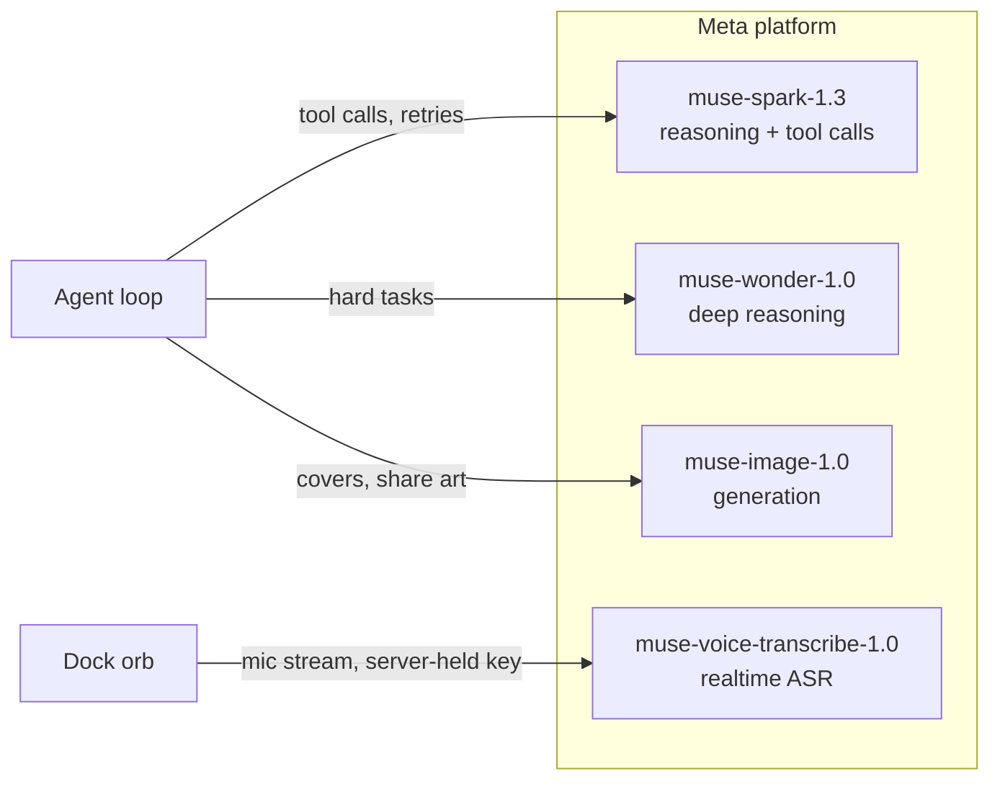

# PolyDocks — judge's guide

Built for the **Meta Global AI Developer Hackathon** (Indie Track). All
product code in this repo is original work written during the competition
period on a fresh scaffold (origin ledger: `internal-docs/NEW_WORK.md`).
No template, no fork, MIT licensed.

## What problem are we solving?

Every AI assistant today lives inside someone else's feature list. You get
a chat box plus the thirty tools a product team pre-chose for you. The
moment your task doesn't fit those tools, you are back to copy-paste:
the agent can't reach your workspace, and your workspace can't learn new
abilities. People adapt to software instead of software adapting to
people.

## Why does this matter?

Work is personal and changes daily — a researcher, a student, and a
founder need different tools on different days. Shipping a new app for
every need doesn't scale, and a chat log is a poor place to do real work.
The missing piece is an environment the agent itself can reshape: open
what exists, build what doesn't, keep what works.

## What is PolyDocks?

A workspace operated by an AI agent called Poly. The interface is a
persistent dock of tool panels (browser, sources feed, notes, terminal,
plus anything Poly builds). You talk or type; Poly operates the dock,
researches the web, runs code in a sandbox, and generates new plugins
that mount into the dock next to everything else. State persists:
notes autosave, tools survive reload, memory carries preferences.

## What makes the approach different?

Three deliberate choices, all visible in the architecture:

1. **The agent builds tools, not just uses them.** `create_plugin` is a
   first-class capability with validation, versioning, and rollback —
   not a code dump in chat. The dock treats generated tools exactly like
   built-in ones.
2. **Everything crosses one typed bus.** Agent, dock, CLI, and HTTP all
   call the same facade functions with the same envelope. There is no
   shadow path where the demo works but the product doesn't.
3. **The core stays boring on purpose.** Dock, capability bus,
   lifecycle/policy, sandbox bridge. No domain logic in core: even
   first-party surfaces (Search, Browser, Notes, Sources, Files,
   Sandbox) are contract plugins under the same manifest and permission
   rules as generated ones.

This is not a chatbot, a dashboard, a marketplace, or a wrapper: there
is no chat-bubble feed as the product, no feature grid to configure, and
the value isn't "AI answers" — it's a workspace that changes shape
around the task.

## What does the agent actually do?

Per turn, the loop (`server/agent/loop.ts`) streams every step over SSE
so you watch it work: it routes fast dock/skill intents deterministically
(`server/agent/orchestrator.ts`), then runs model turns with ~50
zod-validated tools — `dock.open` to arrange the workspace, `notes.*`
and `search.*` for content, `plugins.create/modify` to build, `sandbox.*`
to run code. Failures return as tool results so the model retries;
destructive writes pause for your approval first.

Watch it: [demo walkthrough](../docs/media/videos/polydocks-product-walkthrough.mp4)
(recorded from the live app; capture script: `scripts/capture-demo.ts`).

## What is the role of the Meta technologies?

Meta's platform is the agent's brain, voice, and hands for media:

- **Reasoning + tool calling** — every turn, every tool, every retry.
  Swapping models is one env var; `-contributor` variants are banned so
  user content is never training data.
- **Voice** — hands-free dock operation; realtime transcription proxied
  server-side, replies spoken client-side.
- **Image** — generated art with a daily budget ledger.

Full reference: [meta-model-api.md](meta-model-api.md). Research content
comes from TinyFish (server-side; key never reaches the browser).

## What does the demo prove?

The [demo flow](../internal-docs/demo-script.md) is one continuous take:
theme + background change, TinyFish research into a browsable feed,
three built plugins (breathing exercise, focus timer with persistence,
a brief that composes Sources and Notes through the bus), an edit with
rollback, approval cards, plugin manager toggles, dock rearrangement,
and a reload where everything is still there. The closing message is the
thesis: *one dock, one agent, tools built around you.*

## What are the important technical decisions?

- **Microkernel + capability bus** over a feature monolith
  ([ADR 0001](../internal-docs/adr/0001-dock-plugin-architecture-and-day1-agentic-apis.md)).
- **Demo-first local, cloud as a post-demo fork** — no auth theater in
  the prototype ([ADR 0002](../internal-docs/adr/0002-single-codebase-local-cloud-modes.md)).
- **Contract plugins, including ours** — first-party surfaces meet the
  same manifest/lifecycle bar as generated ones
  ([ADR 0003](../internal-docs/adr/0003-first-party-core-plugins.md)).
- **Fail closed everywhere** — missing keys, unconfigured sandboxes,
  and unapproved writes produce honest errors, never silent nothing.
  Until per-user isolation ships, the server must not be exposed beyond
  localhost.

## What could this become?

The target in `ARCHITECTURE.md`: per-user sandboxes with the agent as a
privileged first-party plugin under the same policy as everything else —
your tools, portable, auditable, and compounding. Today's prototype
already draws that line: the only things missing are isolation and
tenancy, not architecture.
